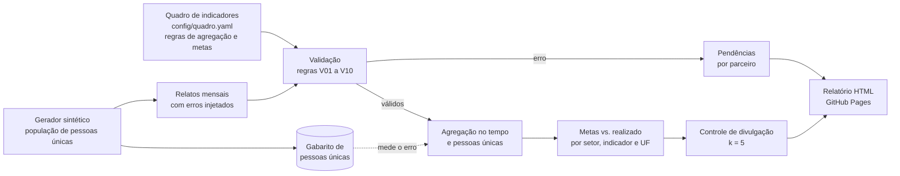

# monitoring-5w-kit

[Português](README.md) | **English**

[](https://github.com/agdala/monitoring-5w-kit/actions/workflows/tests.yml)
[](https://agdala.github.io/monitoring-5w-kit/)

Humanitarian response monitoring in the 5W format, with validation of partner reports, target tracking and estimation of unique people without double counting.

**Published report:** <https://agdala.github.io/monitoring-5w-kit/>

The **5W** format answers who does what, where, when and for whom. The project validates partners'
monthly reports, tracks targets and estimates unique people when several partners serve the same
place.

> [!IMPORTANT]
> **100% synthetic data.** Partners, people, targets and reports are generated by code with a fixed
> seed. No number represents a real operation, plan or organization.
> Only the municipality codes and the state boundaries come from IBGE ([sources](data/ref/FONTES.md)).

---

## 1. Problem

Dozens of organizations report every month what they did against an indicator framework with
targets. Reports arrive with errors, targets are tracked with wrong summation rules and the same
person served by two partners is counted twice. This project shows, end to end, how to handle the
three problems.

## 2. Flow



_Diagram labels are kept in Portuguese, as in the code: indicator framework → validation (rules V01
to V10) → pending issues per partner or aggregation over time and unique people → targets vs.
achieved → disclosure control → HTML report. The synthetic generator produces the monthly reports
with injected errors and the ground truth of unique people._

| Step | Command | Main outputs |
|---|---|---|
| Generate | `m5w generate` | `data/sintetico/relatos.csv`, `gabarito_pessoas_unicas.csv`, `erros_injetados.csv`, `pin.csv` |
| Validate | `m5w validate` | `reports/relatos_validos.csv`, `pendencias_por_parceiro.csv`, `qualidade_parceiros.csv`, `deteccao_erros.csv` |
| Aggregate | `m5w aggregate` | `reports/metas_vs_realizado.csv`, `pessoas_unicas_metodos.csv`, `publicacao/pessoas_desagregadas_uf.csv` |
| Report | `m5w report` | `reports/relatorio.html` |
| All | `make run` (or `m5w run`) | all of the above and `reports/metricas.json` |

### 2.1 Indicator framework

4 sectors and 11 indicators ([config/quadro.yaml](config/quadro.yaml)). People indicators require
disaggregation by sex (2) and age band (0 to 17, 18 to 59, 60 or over).

| Sector | Indicator | Unit | Aggregation over time |
|---|---|---|---|
| Protection | PRO-01 People assisted in case management (new in the month) | people | sum |
| | PRO-02 Legal counselling sessions | activities | sum |
| | PRO-03 People with regularized documentation (cumulative in the year) | people | last value |
| Shelter | ABR-01 People assisted with temporary shelter (new in the month) | people | sum |
| | ABR-02 People sheltered on the last day of the month | people | maximum |
| | ABR-03 Non-food item kits | activities | sum |
| Socioeconomic integration | INT-01 People assisted (new in the month) | people | sum |
| | INT-02 People placed in the labour market (cumulative in the year) | people | last value |
| Health | SAU-01 People assisted (new in the month) | people | sum |
| | SAU-02 Consultations and care sessions | activities | sum |
| | SAU-03 Health facilities supported | activities | maximum |

### 2.2 Synthetic data

| Item | Value |
|---|---|
| Partners | 25 (3 with national coverage) |
| States and municipalities | 14 states, 23 municipalities with IBGE code |
| Unique people in the synthetic population | 57,510 |
| People served by more than one partner | 14.62% |
| Monthly reports | 3,634 |
| Reports with an injected error | 609 (16.76%) |

Order matters: first the population of unique people is created, each person linked to one or more
partners in the same municipality (through referrals); then the reports are derived from it. That
is why the ground truth is reliable. The population is not written to disk, only the aggregated
ground truth.

## 3. How to run

Requires Python 3.10 or later. There are no network calls at run time: the IBGE references are
versioned in `data/ref/`.

### 3.1 On Windows, with Visual Studio Code

1. Install [Python](https://www.python.org/downloads/) (tick *Add python.exe to PATH*) and
   [Git](https://git-scm.com/download/win).
2. In VS Code, open the command palette (`Ctrl+Shift+P`), choose **Git: Clone** and paste
   `https://github.com/agdala/monitoring-5w-kit`.
3. Open the terminal (`Ctrl+'`) and create the environment:

```powershell
python -m venv .venv
```

```powershell
.venv\Scripts\Activate.ps1
```

```powershell
pip install -e ".[dev]"
```

4. Run the pipeline (`make` does not ship with Windows; the command below is equivalent to `make run`):

```powershell
python -m m5w run
```

5. Open `reports\relatorio.html` in the browser. For the tests: `pytest`.

### 3.2 On Linux or macOS

```bash
git clone https://github.com/agdala/monitoring-5w-kit && cd monitoring-5w-kit
```

```bash
python3 -m venv .venv && source .venv/bin/activate
```

```bash
pip install -e ".[dev]"
```

```bash
make run
```

```bash
make test
```

Each step also runs on its own: `m5w generate`, `m5w validate`, `m5w aggregate`, `m5w report`.

## 4. Results

All numbers in this section come from [`reports/metricas.json`](reports/metricas.json), which CI
regenerates from scratch and compares with the repository version on Python 3.10 and 3.12.

### 4.1 Validation and error detection

An error **blocks** the report until it is corrected; an alert **does not block**. Each pending
issue comes with a message to the partner in `reports/pendencias_por_parceiro.csv`. The rules are
declared only once in [`src/m5w/rules.py`](src/m5w/rules.py).

| Rule | Severity | Injected error | Injected | Detection | Precision |
|---|---|---|---:|---:|---:|
| V01 Required fields and period | error | (not injected) | | | |
| V02 Indicator not in the framework | error | non-existent indicator or missing hyphen | 21 | 100.0% | 100.0% |
| V03 Invalid municipality code | error | 6-digit or non-existent code | 36 | 100.0% | 100.0% |
| V04 Municipality outside the state | error | municipality from another state | 36 | 100.0% | 100.0% |
| V05 Duplicated report | error | report resubmitted | 71 | 100.0% | 100.0% |
| V06 Disaggregation does not add up to the total | error | cell altered or empty | 107 | 100.0% | 100.0% |
| V07 Implausible value | error | one or two extra zeros | 21 | 76.2% | 88.9% |
| V08 Cumulative reported as monthly | error | cumulative series (whole year or from mid-year) | 68 | 98.5% | 100.0% |
| V09 Late report | alert | submitted after the 10th | 249 | 100.0% | 100.0% |
| V10 Atypical variation | alert | (not injected) | | | |

- **Overall detection:** 99.01% of the injected errors.
- **Blocked:** 354 of 3,634 reports (9.74%). Passed with an alert: 262.
- **V10** flagged 21 reports; 5 of them are implausible values that V07 let through. The alert is
  the second line of defence.
- **Quality index per partner** (50% validity, 25% compliance, 25% timeliness): mean 92.8, minimum
  86.4, maximum 96.0. Band A: 3 partners; band B: 22.

The deterministic rules (V02 to V06, V09) get everything right by construction. The real test is
in the heuristics: V07 and V08 have a detection floor in CI, so that a deterioration shows up.

### 4.2 Double counting: three methods against the ground truth

Ground truth: **57,510** unique people. Total error over the sum of all sectors and states.

| Method | How it estimates | Error, error-free reports | Error, valid reports | Mean absolute error (sector x state, valid) |
|---|---|---:|---:|---:|
| Simple sum | adds up all partners | +16.47% | +8.14% | 11.02% |
| Maximum per municipality and sector | only the largest partner in each municipality | −20.30% | −24.54% | 21.12% |
| **Union under independence** (official) | PIN × (1 − Π(1 − nᵢ/PIN)) | **+8.18%** | **+1.35%** | **7.51%** |

Unique people estimated with valid reports: sum 62,191; maximum 43,396; union 58,287.

How to read it:

- **With error-free reports**, the sum is the ceiling and the maximum is the floor of the true
  value (tested for every sector x state). The union lies between the two and errs less, but
  **overestimates**: partners refer people to each other, so the overlap is larger than chance
  predicts.
- **With valid reports**, the blocks remove data and pull all methods down. The union's +1.35% is
  partly compensation between the method's overestimation and the loss due to blocking, not
  precision. The honest number for the method is the one in the "error-free" column.
- The third method needs the **people in need (PIN)** figure per municipality and sector. In a real
  operation, the PIN has its own error, which propagates into the estimate.

### 4.3 Target achievement

Achieved in the year over the target, adding up the states with a target. People assisted use the
official method.

| Sector | Indicator | Target | Achieved | Achievement |
|---|---|---:|---:|---:|
| Protection | PRO-01 People assisted | 19,860 | 18,108 | 91.2% |
| | PRO-02 Legal counselling sessions | 19,040 | 18,322 | 96.2% |
| | PRO-03 Regularized documentation | 8,358 | 7,890 | 94.4% |
| Shelter | ABR-01 People assisted | 7,995 | 8,425 | 105.4% |
| | ABR-02 People sheltered (peak) | 2,383 | 2,219 | 93.1% |
| | ABR-03 Kits distributed | 17,610 | 13,382 | 76.0% |
| Integration | INT-01 People assisted | 12,422 | 10,785 | 86.8% |
| | INT-02 Placed in the labour market | 2,408 | 2,630 | 109.2% |
| Health | SAU-01 People assisted | 22,950 | 20,969 | 91.4% |
| | SAU-02 Consultations and care sessions | 65,670 | 63,133 | 96.1% |
| | SAU-03 Health facilities supported (peak) | 96 | 110 | 114.6% |

- 50 of 115 targets (indicator x state) met; 1 below 50%.
- Achievement of the people-assisted target per state: from 59.0% (BA) to 122.6% (MT). See the map in the report.
- **Why the aggregation rule matters:** adding up stock or cumulative indicators month by month
  would inflate the result by 700.9% (ABR-02), 412.8% (PRO-03), 387.0% (INT-02) and 694.7% (SAU-03).

### 4.4 Disclosure control

The published table `reports/publicacao/pessoas_desagregadas_uf.csv` (indicator x state x sex x
age band) follows the same criterion as [sismigra-analytics](https://github.com/agdala/sismigra-analytics):
no cell with 1 to 4 people (k = 5). Of the 525 cells, 39 have primary suppression and 10 secondary
suppression (so that the cell cannot be recovered from the total). Cells with 1 to 4 published: 0.
Details in [docs/protecao_de_dados.md](docs/protecao_de_dados.md) (in Portuguese).

## 5. Technical decisions

| Decision | Why |
|---|---|
| **Population of people before the reports** | It is the only way to have a ground truth of unique people that does not depend on the reports themselves. Overlap comes from referrals between partners (dependent), not from independent sampling, so as not to favour the union method. |
| **Injected errors with a log** | Each error has its report and type recorded in `erros_injetados.csv`. That way, the detection and precision of each rule are measured, not asserted. |
| **"Hard" generator on purpose** | An extra zero at ×10 (not just ×100), cumulative series starting mid-year and legitimate campaign peaks. Without this, every rule scored 100% and the test proved nothing. |
| **Rules declared only once** | Code, severity, message and function stay together in `rules.py`. Report, pending issues and tests read the same list. |
| **Errors block, alerts do not** | An error distorts the aggregate (duplicate, cumulative, extra zero). Delays and atypical variation do not: the data goes in and the partner is notified. |
| **Maximum for stocks: sum within the month, peak in the year** | Sheltered people add up across partners in the same month, but not across months. Summing each partner's peak would produce a month that never existed. |
| **Union under independence as the official method** | It had the smallest error on error-free reports (+8.18%, against +16.47% for the sum and −20.30% for the maximum). The maximum, common as a conservative criterion, underestimated by about a fifth. The choice is configurable in `quadro.yaml` and the report shows all three. |
| **Disaggregation of the official total by largest remainder** | The unique-people method produces a total; the sex and age cells are distributed in the reported proportion, preserving the exact total. |
| **SVG generated by the code itself** | Report in a single file, with no charting library or network, deterministic (CI compares it byte by byte). |
| **IBGE boundaries dissolved and simplified** | The IBGE API was not reachable in the build environment. The IBGE municipal boundaries redistributed under CC0 were dissolved into states and simplified by `scripts/construir_refs.py`, which is kept in the repository. |
| **Pinned dependencies** | numpy, pandas and Faker with exact versions: the same seed generates the same numbers on 3.10 and 3.12. |

## 6. Limitations

- **Generator, rules and targets were made by the same author.** The detection rates measure the
  consistency of the method against errors that I imagined myself. Real data has errors that are
  not in the generator.
- **One heuristic was tuned after seeing the result.** The V07 median floor dropped from 3 to 1
  because it let extra zeros through in small series (health facilities supported reached more than
  twice the target). This is tuning to the generator itself: on real data, the threshold must be
  revisited.
- **The targets were calibrated from the true value** (`scripts/calibrar_metas.py`), only once, to
  have a plausible order of magnitude. In a real plan, the target comes before the data.
- **The official method was also chosen while looking at the ground truth.** Without a ground
  truth, the choice requires a record linkage study on a sample (see next steps).
- **Blocked reports disappear from the aggregate.** In practice, the partner corrects and
  resubmits; here there is no correction cycle, so the achieved value is underestimated in
  proportion to the blocks.
- **Overlap only within the municipality and the sector.** People who move between municipalities
  or use several sectors do not create double counting across sectors in the model.
- **Small scale:** 25 partners, 12 months and 23 municipalities. V07 has only 21 injected cases, so
  the 76.2% rate has high uncertainty.

## 7. Next steps

1. **Correction cycle:** resubmission of blocked reports and measurement of the time to correction per partner.
2. **Calibrate double counting with real linkage on a sample:** use
   [record-linkage-kit](https://github.com/agdala/record-linkage-kit) on a pair of municipalities,
   under a data sharing agreement, to estimate the overlap rate and correct the union under independence.
3. **Uncertainty interval** for unique people (varying the PIN and the overlap), instead of a single number.
4. **Form validation at the source:** the same rules exported to the partner's form (for example,
   KoboToolbox or a spreadsheet with validation), so that the error does not reach consolidation.
5. **Time series:** compare months and years to detect drops in reporting (a partner that stopped reporting).

## 8. Repository structure

```
config/          quadro.yaml (indicators, rules, targets) and gerador.yaml (synthetic parameters)
data/ref/        IBGE municipalities and state boundaries, with FONTES.md
src/m5w/         generate, rules + validate, tempo + aggregate, disclosure, charts + report, cli
scripts/         construir_refs.py and calibrar_metas.py (run once, outside the pipeline)
reports/         versioned outputs: metricas.json, CSVs, relatorio.html, publicacao/
docs/            protecao_de_dados.md
tests/           tests per step (pytest)
```

## Related projects

The four repositories form a data cycle, from collection to monitoring:

| Stage | Project | What it does | Published |
|---|---|---|---|
| 1. Collect | [xlsform-validator](https://github.com/agdala/xlsform-validator) | Quality, consent and LGPD (Brazil's General Data Protection Law) checks for KoboToolbox/ODK forms | [web version](https://agdala.github.io/xlsform-validator/) |
| 2. Transform and publish | [sismigra-analytics](https://github.com/agdala/sismigra-analytics) | Bronze/silver/gold pipeline with Python, DuckDB and dbt, with disclosure control | [dbt docs](https://agdala.github.io/sismigra-analytics/) |
| 3. Integrate | [record-linkage-kit](https://github.com/agdala/record-linkage-kit) | Deduplication and linkage of registries, with human review and pseudonymization | [report](https://agdala.github.io/record-linkage-kit/) |
| 4. Monitor | **monitoring-5w-kit** (this repository) | Partner reports, targets and double counting | [report](https://agdala.github.io/monitoring-5w-kit/) |

Author: Agda Santos, with the assistance of AI tools.

## License

[MIT](LICENSE). Geographic references: see [data/ref/FONTES.md](data/ref/FONTES.md).
