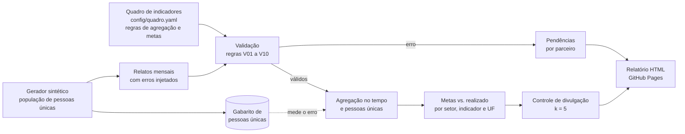

# monitoring-5w-kit

[](https://github.com/agdala/monitoring-5w-kit/actions/workflows/tests.yml)
[](https://agdala.github.io/monitoring-5w-kit/)

Monitoramento de resposta humanitária no formato 5W, com validação dos relatos de parceiros, acompanhamento de metas e estimativa de pessoas únicas sem dupla contagem.

**Relatório publicado:** <https://agdala.github.io/monitoring-5w-kit/>

O formato **5W** responde quem faz o quê, onde, quando e para quem. O projeto valida os relatos
mensais dos parceiros, acompanha as metas e estima as pessoas únicas quando vários parceiros
atendem o mesmo lugar.

> [!IMPORTANT]
> **Dados 100% sintéticos.** Parceiros, pessoas, metas e relatos são gerados por código com
> semente fixa. Nenhum número representa uma operação, um plano ou uma organização real.
> Só os códigos de município e a malha das UFs vêm do IBGE ([fontes](data/ref/FONTES.md)).

---

## 1. Problema

Dezenas de organizações relatam todo mês o que fizeram contra um quadro de indicadores com metas.
Os relatos chegam com erro, as metas são acompanhadas com regras de soma erradas e a mesma pessoa
atendida por dois parceiros é contada duas vezes. Este projeto mostra, de ponta a ponta, como tratar os três problemas.

## 2. Fluxo



| Etapa | Comando | Saídas principais |
|---|---|---|
| Gerar | `m5w generate` | `data/sintetico/relatos.csv`, `gabarito_pessoas_unicas.csv`, `erros_injetados.csv`, `pin.csv` |
| Validar | `m5w validate` | `reports/relatos_validos.csv`, `pendencias_por_parceiro.csv`, `qualidade_parceiros.csv`, `deteccao_erros.csv` |
| Agregar | `m5w aggregate` | `reports/metas_vs_realizado.csv`, `pessoas_unicas_metodos.csv`, `publicacao/pessoas_desagregadas_uf.csv` |
| Relatório | `m5w report` | `reports/relatorio.html` |
| Tudo | `make run` (ou `m5w run`) | todas as anteriores e `reports/metricas.json` |

### 2.1 Quadro de indicadores

4 setores e 11 indicadores ([config/quadro.yaml](config/quadro.yaml)). Indicadores de pessoas
exigem desagregação por sexo (2) e faixa etária (0 a 17, 18 a 59, 60 ou mais).

| Setor | Indicador | Unidade | Agregação no tempo |
|---|---|---|---|
| Proteção | PRO-01 Pessoas atendidas em gestão de casos (novas no mês) | pessoas | soma |
| | PRO-02 Sessões de orientação jurídica | atividades | soma |
| | PRO-03 Pessoas com documentação regularizada (acumulado no ano) | pessoas | último valor |
| Abrigo | ABR-01 Pessoas atendidas com abrigo temporário (novas no mês) | pessoas | soma |
| | ABR-02 Pessoas abrigadas no último dia do mês | pessoas | máximo |
| | ABR-03 Kits de itens não alimentares | atividades | soma |
| Integração socioeconômica | INT-01 Pessoas atendidas (novas no mês) | pessoas | soma |
| | INT-02 Pessoas inseridas no mercado de trabalho (acumulado no ano) | pessoas | último valor |
| Saúde | SAU-01 Pessoas atendidas (novas no mês) | pessoas | soma |
| | SAU-02 Consultas e atendimentos | atividades | soma |
| | SAU-03 Unidades de saúde apoiadas | atividades | máximo |

### 2.2 Dados sintéticos

| Item | Valor |
|---|---|
| Parceiros | 25 (3 de atuação nacional) |
| UFs e municípios | 14 UFs, 23 municípios com código IBGE |
| Pessoas únicas na população sintética | 57.510 |
| Pessoas atendidas por mais de um parceiro | 14,62% |
| Relatos mensais | 3.634 |
| Relatos com erro injetado | 609 (16,76%) |

A ordem importa: primeiro nasce a população de pessoas únicas, cada uma ligada a um ou mais
parceiros do mesmo município (por encaminhamento); depois os relatos são derivados dela. Por isso
o gabarito é confiável. A população não é gravada em disco, só o gabarito agregado.

## 3. Como rodar

Requer Python 3.10 ou superior. Não há chamada de rede em tempo de execução: as referências do
IBGE estão versionadas em `data/ref/`.

### 3.1 No Windows, com o Visual Studio Code

1. Instale o [Python](https://www.python.org/downloads/) (marque *Add python.exe to PATH*) e o
   [Git](https://git-scm.com/download/win).
2. No VS Code, abra a paleta (`Ctrl+Shift+P`), escolha **Git: Clone** e cole
   `https://github.com/agdala/monitoring-5w-kit`.
3. Abra o terminal (`Ctrl+'`) e crie o ambiente:

```powershell
python -m venv .venv
```

```powershell
.venv\Scripts\Activate.ps1
```

```powershell
pip install -e ".[dev]"
```

4. Rode o pipeline (o `make` não vem no Windows; o comando abaixo é equivalente ao `make run`):

```powershell
python -m m5w run
```

5. Abra `reports\relatorio.html` no navegador. Para os testes: `pytest`.

### 3.2 No Linux ou macOS

```bash
git clone https://github.com/agdala/monitoring-5w-kit && cd monitoring-5w-kit
```

```bash
python3 -m venv .venv && source .venv/bin/activate
```

```bash
pip install -e ".[dev]"
```

```bash
make run
```

```bash
make test
```

Cada etapa também roda sozinha: `m5w generate`, `m5w validate`, `m5w aggregate`, `m5w report`.

## 4. Resultados

Todos os números desta seção vêm de [`reports/metricas.json`](reports/metricas.json), que o CI
regenera do zero e compara com a versão do repositório em Python 3.10 e 3.12.

### 4.1 Validação e detecção de erros

Erro **bloqueia** o relato até a correção; alerta **não bloqueia**. Cada pendência sai com uma
mensagem para o parceiro em `reports/pendencias_por_parceiro.csv`. As regras estão declaradas uma
única vez em [`src/m5w/rules.py`](src/m5w/rules.py).

| Regra | Severidade | Erro injetado | Injetados | Detecção | Precisão |
|---|---|---|---:|---:|---:|
| V01 Campos obrigatórios e período | erro | (não injetado) | | | |
| V02 Indicador fora do quadro | erro | indicador inexistente ou sem hífen | 21 | 100,0% | 100,0% |
| V03 Código de município inválido | erro | código de 6 dígitos ou inexistente | 36 | 100,0% | 100,0% |
| V04 Município fora da UF | erro | município de outra UF | 36 | 100,0% | 100,0% |
| V05 Relato duplicado | erro | relato reenviado | 71 | 100,0% | 100,0% |
| V06 Desagregação não soma o total | erro | célula alterada ou vazia | 107 | 100,0% | 100,0% |
| V07 Valor implausível | erro | um ou dois zeros a mais | 21 | 76,2% | 88,9% |
| V08 Acumulado informado como mensal | erro | série acumulada (ano todo ou a partir do meio) | 68 | 98,5% | 100,0% |
| V09 Relato fora do prazo | alerta | envio depois do dia 10 | 249 | 100,0% | 100,0% |
| V10 Variação atípica | alerta | (não injetado) | | | |

- **Detecção global:** 99,01% dos erros injetados.
- **Bloqueados:** 354 de 3.634 relatos (9,74%). Seguem com alerta: 262.
- **V10** sinalizou 21 relatos; 5 deles são valores implausíveis que o V07 deixou passar. O alerta
  é a segunda linha de defesa.
- **Índice de qualidade por parceiro** (50% validade, 25% conformidade, 25% pontualidade): média
  92,8, mínimo 86,4, máximo 96,0. Faixa A: 3 parceiros; faixa B: 22.

As regras determinísticas (V02 a V06, V09) acertam tudo por construção. O teste real está nas
heurísticas: V07 e V08 têm piso de detecção no CI, para que uma piora apareça.

### 4.2 Dupla contagem: três métodos contra o gabarito

Gabarito: **57.510** pessoas únicas. Erro total sobre a soma de todos os setores e UFs.

| Método | Como estima | Erro, relatos sem erros | Erro, relatos válidos | Erro absoluto médio (setor x UF, válidos) |
|---|---|---:|---:|---:|
| Soma simples | soma todos os parceiros | +16,47% | +8,14% | 11,02% |
| Máximo por município e setor | só o maior parceiro de cada município | −20,30% | −24,54% | 21,12% |
| **União sob independência** (oficial) | PIN × (1 − Π(1 − nᵢ/PIN)) | **+8,18%** | **+1,35%** | **7,51%** |

Pessoas únicas estimadas com relatos válidos: soma 62.191; máximo 43.396; união 58.287.

Como ler:

- **Sem erros nos relatos**, a soma é o teto e o máximo é o piso do valor real (testado em todo
  setor x UF). A união fica entre os dois e erra menos, mas **superestima**: os parceiros se
  encaminham pessoas, então a sobreposição é maior do que o acaso prevê.
- **Com relatos válidos**, os bloqueios retiram dados e puxam todos os métodos para baixo. O
  +1,35% da união é em parte compensação entre a superestimação do método e a perda por bloqueio,
  não precisão. O número honesto do método é o da coluna "sem erros".
- O terceiro método precisa da **população em necessidade (PIN)** por município e setor. Em
  operação real, o PIN tem erro próprio, que se propaga para a estimativa.

### 4.3 Alcance das metas

Realizado no ano sobre a meta, somando as UFs com meta. Pessoas atendidas usam o método oficial.

| Setor | Indicador | Meta | Realizado | Alcance |
|---|---|---:|---:|---:|
| Proteção | PRO-01 Pessoas atendidas | 19.860 | 18.108 | 91,2% |
| | PRO-02 Sessões de orientação jurídica | 19.040 | 18.322 | 96,2% |
| | PRO-03 Documentação regularizada | 8.358 | 7.890 | 94,4% |
| Abrigo | ABR-01 Pessoas atendidas | 7.995 | 8.425 | 105,4% |
| | ABR-02 Pessoas abrigadas (pico) | 2.383 | 2.219 | 93,1% |
| | ABR-03 Kits distribuídos | 17.610 | 13.382 | 76,0% |
| Integração | INT-01 Pessoas atendidas | 12.422 | 10.785 | 86,8% |
| | INT-02 Inseridas no mercado de trabalho | 2.408 | 2.630 | 109,2% |
| Saúde | SAU-01 Pessoas atendidas | 22.950 | 20.969 | 91,4% |
| | SAU-02 Consultas e atendimentos | 65.670 | 63.133 | 96,1% |
| | SAU-03 Unidades de saúde apoiadas (pico) | 96 | 110 | 114,6% |

- 50 de 115 metas (indicador x UF) atingidas; 1 abaixo de 50%.
- Alcance da meta de pessoas atendidas por UF: de 59,0% (BA) a 122,6% (MT). Ver o mapa no relatório.
- **Por que a regra de agregação importa:** somar mês a mês os indicadores de estoque ou acumulado
  inflaria o resultado em 700,9% (ABR-02), 412,8% (PRO-03), 387,0% (INT-02) e 694,7% (SAU-03).

### 4.4 Controle de divulgação

A tabela publicada `reports/publicacao/pessoas_desagregadas_uf.csv` (indicador x UF x sexo x faixa)
segue o mesmo critério do [sismigra-analytics](https://github.com/agdala/sismigra-analytics):
nenhuma célula de 1 a 4 pessoas (k = 5). Das 525 células, 39 têm supressão primária e 10
secundária (para que a célula não seja recuperada pelo total). Células de 1 a 4 publicadas: 0.
Detalhes em [docs/protecao_de_dados.md](docs/protecao_de_dados.md).

## 5. Decisões técnicas

| Decisão | Por quê |
|---|---|
| **População de pessoas antes dos relatos** | É o único jeito de ter um gabarito de pessoas únicas que não dependa dos próprios relatos. A sobreposição vem de encaminhamento entre parceiros (dependente), não de sorteio independente, para não favorecer o método de união. |
| **Erros injetados com registro** | Cada erro tem o relato e o tipo gravados em `erros_injetados.csv`. Assim, detecção e precisão de cada regra são medidas, não afirmadas. |
| **Gerador "difícil" de propósito** | Zero a mais em ×10 (não só ×100), acumulado que começa no meio do ano e picos legítimos de campanha. Sem isso, todas as regras davam 100% e o teste não provava nada. |
| **Regras declaradas uma única vez** | Código, severidade, mensagem e função ficam juntos em `rules.py`. Relatório, pendências e testes leem a mesma lista. |
| **Erro bloqueia, alerta não** | Erro distorce o agregado (duplicado, acumulado, zero a mais). Atraso e variação atípica não distorcem: o dado entra e o parceiro é avisado. |
| **Máximo para estoque: soma no mês, pico no ano** | Pessoas abrigadas se somam entre parceiros no mesmo mês, mas não entre meses. O pico de cada parceiro somado daria um mês que não existiu. |
| **União sob independência como método oficial** | Foi o de menor erro sem erros nos relatos (+8,18%, contra +16,47% da soma e −20,30% do máximo). O máximo, comum como critério conservador, subestimou cerca de um quinto. A escolha é configurável em `quadro.yaml` e o relatório mostra os três. |
| **Desagregação do total oficial pelo maior resto** | O método de pessoas únicas produz um total; as células de sexo e idade são distribuídas na proporção relatada, preservando o total exato. |
| **SVG gerado pelo próprio código** | Relatório num arquivo só, sem biblioteca gráfica nem rede, determinístico (o CI compara byte a byte). |
| **Malha do IBGE dissolvida e simplificada** | A API do IBGE não estava acessível no ambiente de construção. A malha municipal do IBGE redistribuída em CC0 foi dissolvida em UFs e simplificada por `scripts/construir_refs.py`, que fica no repositório. |
| **Dependências fixadas** | numpy, pandas e Faker com versão exata: a mesma semente gera os mesmos números em 3.10 e 3.12. |

## 6. Limitações

- **Gerador, regras e metas foram feitos pela mesma autora.** As taxas de detecção medem a
  coerência do método contra erros que eu mesma imaginei. Em dados reais aparecem erros que não
  estão no gerador.
- **Uma heurística foi ajustada depois de ver o resultado.** O piso da mediana do V07 caiu de 3
  para 1 porque deixava passar zero a mais em séries pequenas (unidades de saúde apoiadas chegavam
  a mais que o dobro da meta). É ajuste ao próprio gerador: em dados reais, o limiar precisa ser revisto.
- **As metas foram calibradas a partir do valor verdadeiro** (`scripts/calibrar_metas.py`), uma
  única vez, para ter ordem de grandeza plausível. Num plano real, a meta vem antes dos dados.
- **O método oficial também foi escolhido vendo o gabarito.** Sem gabarito, a escolha exige um
  estudo de cruzamento de registros numa amostra (ver próximos passos).
- **Relatos bloqueados somem do agregado.** Na prática, o parceiro corrige e reenvia; aqui não há
  ciclo de correção, então o realizado é subestimado na proporção dos bloqueios.
- **Sobreposição só dentro do município e do setor.** Pessoas que mudam de município ou usam
  vários setores não geram dupla contagem entre setores no modelo.
- **Escala pequena:** 25 parceiros, 12 meses e 23 municípios. V07 tem só 21 casos injetados, então
  a taxa de 76,2% tem incerteza alta.

## 7. Próximos passos

1. **Ciclo de correção:** reenvio dos relatos bloqueados e medição do tempo até a correção por parceiro.
2. **Calibrar a dupla contagem com cruzamento real numa amostra:** usar o
   [record-linkage-kit](https://github.com/agdala/record-linkage-kit) num par de municípios, com
   acordo de compartilhamento, para estimar a taxa de sobreposição e corrigir a união sob independência.
3. **Intervalo de incerteza** para as pessoas únicas (variando o PIN e a sobreposição), em vez de um número único.
4. **Validação de formulário na origem:** as mesmas regras exportadas para o formulário do parceiro
   (por exemplo, KoboToolbox ou planilha com validação), para o erro não chegar à consolidação.
5. **Série histórica:** comparar meses e anos para detectar quedas de relato (parceiro que parou de relatar).

## 8. Estrutura do repositório

```
config/          quadro.yaml (indicadores, regras, metas) e gerador.yaml (parâmetros sintéticos)
data/ref/        municípios IBGE e malha das UFs, com FONTES.md
src/m5w/         generate, rules + validate, tempo + aggregate, disclosure, charts + report, cli
scripts/         construir_refs.py e calibrar_metas.py (rodados uma vez, fora do pipeline)
reports/         saídas versionadas: metricas.json, CSVs, relatorio.html, publicacao/
docs/            protecao_de_dados.md
tests/           testes por etapa (pytest)
```

---

## English summary

**monitoring-5w-kit** simulates the monthly 5W (who does what, where, when, for whom) monitoring
of a humanitarian response with 100% synthetic data: 25 fictitious partners, 14 Brazilian states,
23 municipalities with official IBGE codes, 11 indicators across protection, shelter,
socioeconomic integration and health, with annual targets per state.

- **Generator:** builds a population of 57,510 unique people first (14.62% served by more than
  one partner, via referrals), then derives 3,634 partner reports from it and injects 8 error types
  (609 reports). This yields a trustworthy ground truth for unique people.
- **Validation:** 10 rules declared once (code, severity, actionable message). Deterministic rules
  catch 100% of their injected errors; the heuristics catch 98.5% (cumulative reported as monthly)
  and 76.2% (implausible values). Overall detection: 99.01%. Each partner gets a to-do list and a
  quality index.
- **Double counting:** on error-free reports, simple sum overestimates unique people by 16.47%,
  max per municipality underestimates by 20.30%, and a union-under-independence estimator using
  people-in-need figures is off by 8.18% (chosen as the official method, configurable).
- **Targets and disclosure:** time aggregation respects each indicator's rule (sum, peak, last
  value); 50 of 115 indicator-state targets were met. Published disaggregated tables have no cell
  between 1 and 4 people (k = 5, with secondary suppression).
- **Output:** a self-contained HTML report with code-generated SVG charts and a state choropleth,
  published to GitHub Pages. CI runs ruff, pytest and the full pipeline on Python 3.10 and 3.12 and
  checks that `reports/metricas.json` reproduces exactly.
- **Limits:** generator, rules and targets were written by the same author; one heuristic threshold
  and the official method were chosen after seeing the synthetic ground truth.

## Projetos relacionados

Os quatro repositórios formam um ciclo de dados, da coleta ao monitoramento:

| Etapa | Projeto | O que faz | Publicado |
|---|---|---|---|
| 1. Coletar | [xlsform-validator](https://github.com/agdala/xlsform-validator) | Qualidade, consentimento e LGPD em formulários KoboToolbox/ODK | [versão web](https://agdala.github.io/xlsform-validator/) |
| 2. Transformar e publicar | [sismigra-analytics](https://github.com/agdala/sismigra-analytics) | Pipeline bronze/prata/ouro com Python, DuckDB e dbt, com controle de divulgação | [dbt docs](https://agdala.github.io/sismigra-analytics/) |
| 3. Integrar | [record-linkage-kit](https://github.com/agdala/record-linkage-kit) | Deduplicação e cruzamento de cadastros, com revisão humana e pseudonimização | [relatório](https://agdala.github.io/record-linkage-kit/) |
| 4. Monitorar | **monitoring-5w-kit** (este repositório) | Relatos de parceiros, metas e dupla contagem | [relatório](https://agdala.github.io/monitoring-5w-kit/) |

Autoria: Agda Santos, com auxílio de ferramentas de IA.

## Licença

[MIT](LICENSE). Referências geográficas: ver [data/ref/FONTES.md](data/ref/FONTES.md).
